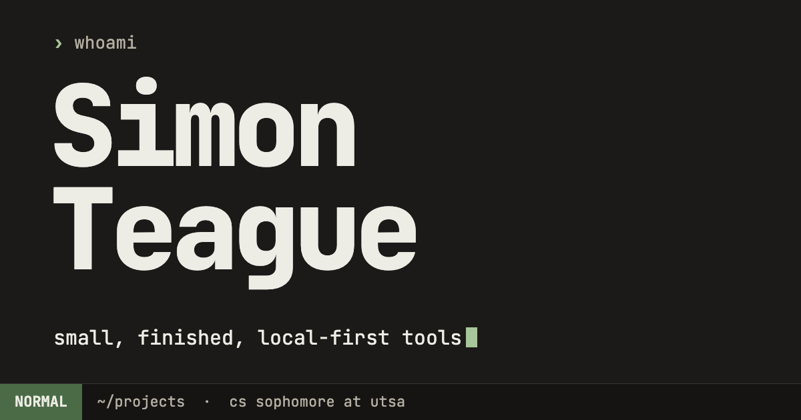

# Simon Teague · portfolio

My personal portfolio: projects, background, and contact links. Built with static HTML, CSS, and vanilla JavaScript—no framework, dependencies, or build step.



## Run locally

Clone the repository and serve it with Python 3:

```sh
git clone https://github.com/simonteague6/portfolio-site.git
cd portfolio-site
python3 -m http.server 8000 --bind 127.0.0.1
```

Open [localhost:8000](http://localhost:8000). Stop the server with `Ctrl+C`.

## Project structure

```text
index.html       Page content, project details, and metadata
css/style.css    Layout, typography, responsive styles, and animations
js/main.js       Project browser, keyboard shortcuts, and terminal interactions
assets/         Images, demo videos, favicon, and locally hosted fonts
```

Edit `index.html` to update projects and personal information. Keep media in `assets/` and use relative paths so the site works at either a domain root or a repository subpath.

## Interactions

- **Browse projects:** use the project list, previous/next buttons, or `j` / `k`.
- **Jump anywhere:** press `/` or `⌘K` / `Ctrl+K` for the command palette.
- **Try the terminal:** type `help` in the homepage prompt.
- **See all shortcuts:** press `?`.

The layout adapts to mobile screens and respects reduced-motion preferences. Fonts and media are served locally; the site has no analytics or tracking scripts.

## Deployment

Upload `index.html`, `css/`, `js/`, and `assets/` to any static host. No install or build command is needed.

For GitHub Pages, select **Settings → Pages → Deploy from a branch → main → / (root)**.

> [!IMPORTANT]
> Research directories and local credentials are excluded by `.gitignore`. Keep private notes outside the published site. Git ignore rules do not prevent a static server from serving files in its directory.
